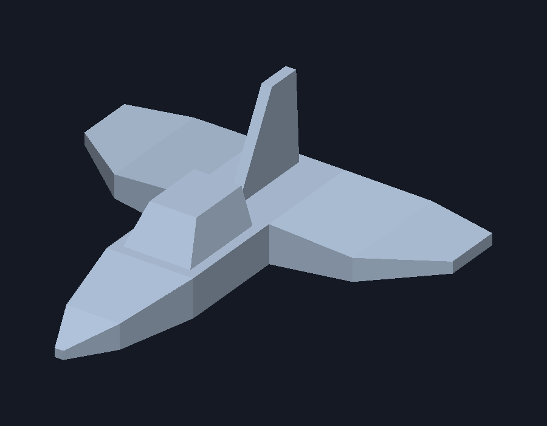

# Luis Hernández Márquez (241424)
# Prof. Pablo Koch
# Lab 4: renderizado de una nave OBJ en Rust 

Carga `nave.obj`, creado en el laboratorio anterior, y dibuja sus triángulos
con un rasterizador propio. El modelo queda centrado y ajustado al 80% del
área disponible en una imagen de 900 × 700 píxeles.



## Ejecutar

Requiere Rust y las herramientas de compilación de Raylib (CMake y un
compilador C/C++), igual que los ejercicios anteriores.

```powershell
cd C:\Graficas\lab_nave
cargo run --release
```

Abre la ventana con la nave y guarda `render.png` en esta misma carpeta.
Para cerrar, usa Escape o el botón de cerrar de la ventana.
Para generar únicamente el PNG:

```powershell
cargo run --release -- --export
```

## Funcionamiento

- `src/obj.rs`: lee las posiciones `v` y las caras triangulares `f`. Extrae el
  primer índice de cada grupo `v/vt/vn` y lo convierte de base 1 a base 0.
- `src/main.rs`: recorre manualmente las caras, obtiene sus tres vértices por
  índice y llama a `triangle`. Aplica una vista ortográfica fija y centra el modelo.
- `src/triangle.rs`: rellena cada triángulo por coordenadas baricéntricas.
- `src/framebuffer.rs`: almacena los píxeles, compara la profundidad para ocultar
  caras traseras y guarda el PNG. El color por cara permite distinguir superficies.

Raylib se utiliza para mostrar la imagen; los triángulos se dibujan en CPU.
No se utiliza un cargador de modelos ni el renderizador 3D de Raylib.
El OBJ debe estar triangulado, como el archivo incluido. No se cargan materiales
ni texturas, ya que no son necesarios para este ejercicio.